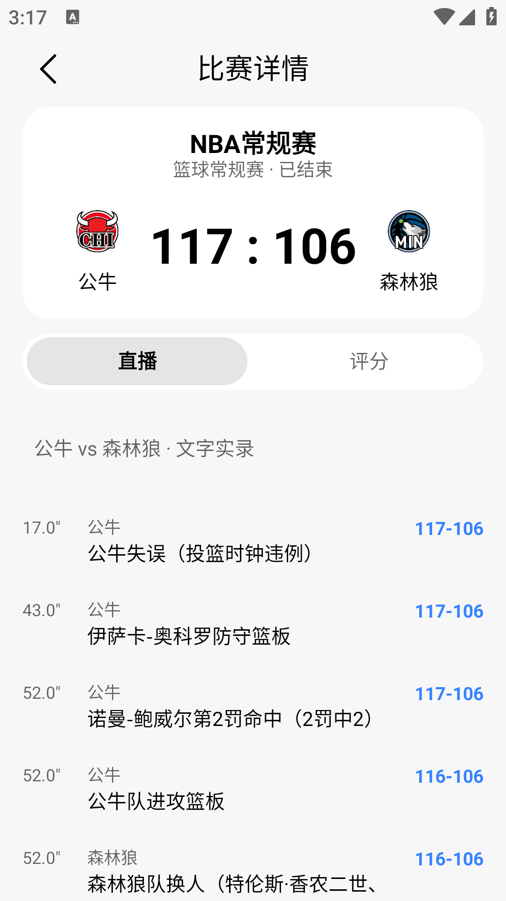
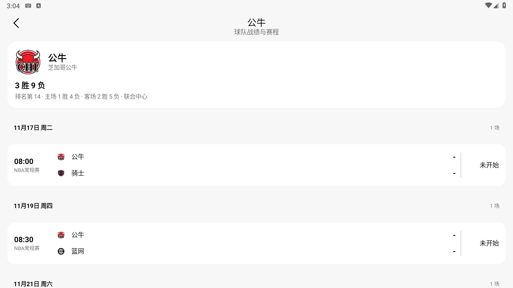

<div align="center">

# 喵扑

Android 第三方虎扑赛事评分客户端

[下载应用](https://github.com/Teruha/Miaopu/releases/latest) · [应用截图](#应用截图) · [问题反馈](https://github.com/Teruha/Miaopu/issues)

</div>

## 简介

喵扑专注于电竞与体育赛事的赛程、选手评分和赛事讨论，涵盖英雄联盟、无畏契约、CS2、篮球、足球等项目。用户可按关注的赛事订阅内容，查看比赛结果、各局选手表现及虎扑社区讨论。

> 本仓库是 [KiritoXDone/Miaopu](https://github.com/KiritoXDone/Miaopu) 的二次开发版本，在原作基础上新增了 NBA 文字直播与球队赛程战绩功能。感谢原作者 [@KiritoXDone](https://github.com/KiritoXDone) 的工作，功能建议与问题反馈欢迎优先前往上游仓库。

## 下载与使用

在 [Releases](https://github.com/Teruha/Miaopu/releases/latest) 下载 APK，支持 **Android 7.0 及以上**版本。

赛事订阅位于 **我的 → 赛事订阅**，支持搜索、分类筛选和调整订阅顺序。首页汇总已订阅项目的比赛，赛事页提供完整赛程与搜索入口。

比赛详情可按局次和队伍查看选手表现；有全场评分或技术统计的比赛，会展示对应内容。选手详情包含评分分布和评论，评论可按最热或最新排序，支持多层回复、点赞与取消点赞。

**NBA 比赛详情提供「直播」页签**：文字实录按时间倒序展示（最新在前），比赛进行中每 3 秒自动刷新，数据来自虎扑网页版实录。点击对阵双方队名或队标可进入球队页，查看本赛季战绩（胜负、排名、主客场）与按时间排序的球队赛程。

浏览赛程、评分和评论无需登录。参与评分、发表评论、回复或点赞需在 **我的** 中登录虎扑账号。应用更新可通过 **我的 → 检查更新** 获取。

桌面提供 **2×2 单场赛况**与 **4×2 近期赛程**两种小部件，跟随应用内的赛事订阅。可在系统的小部件列表中添加，点击比赛查看详情，点击刷新按钮更新数据。

## 应用截图

<table>
  <tr>
    <th>首页 · 赛程汇总</th>
    <th>赛事 · 完整赛程</th>
    <th>赛事搜索</th>
  </tr>
  <tr>
    <td><a href="docs/screenshots/home.png"></a></td>
    <td><a href="docs/screenshots/events.png"></a></td>
    <td><a href="docs/screenshots/search.png"></a></td>
  </tr>
  <tr>
    <th>比赛详情 · 全场评分</th>
    <th>比赛数据 · 分局统计</th>
    <th>选手评分 · 分布与评论</th>
  </tr>
  <tr>
    <td><a href="docs/screenshots/match.png"></a></td>
    <td><a href="docs/screenshots/stats.png"></a></td>
    <td><a href="docs/screenshots/player.png"></a></td>
  </tr>
  <tr>
    <th>评论 · 多层回复</th>
    <th>赛事订阅</th>
    <th>我的喵扑</th>
  </tr>
  <tr>
    <td><a href="docs/screenshots/replies.png"></a></td>
    <td><a href="docs/screenshots/subscriptions.png"></a></td>
    <td><a href="docs/screenshots/profile.png"></a></td>
  </tr>
</table>

<details>
  <summary>查看回复输入界面</summary>
  <p>点击具体评论可打开回复输入区，引用原评论并唤起键盘。</p>
  <a href="docs/screenshots/compose.png"></a>
</details>

### 桌面小部件

<table>
  <tr>
    <th>4×2 · 近期赛程</th>
    <th>2×2 · 单场赛况</th>
  </tr>
  <tr>
    <td><a href="docs/screenshots/widget-4x2.png"></a></td>
    <td><a href="docs/screenshots/widget-2x2.png"></a></td>
  </tr>
</table>

### 本仓库新增

<table>
  <tr>
    <th>比赛详情 · 文字实录</th>
    <th>球队页 · 战绩与赛程</th>
  </tr>
  <tr>
    <td><a href="docs/screenshots/text-live.png"></a></td>
    <td><a href="docs/screenshots/team.png"></a></td>
  </tr>
</table>

比赛进行中每 3 秒自动刷新，节次行高亮标记；历史比赛从最后一场往前回看。点击比赛详情中的队名或队标进入球队页，赛程按未开始（从近到远）、已完场（从近到远）排序。

## 反馈与贡献

问题反馈和功能建议请提交至 [Issues](https://github.com/Teruha/Miaopu/issues)。问题报告请附上应用版本、Android 版本、相关赛事及复现步骤，必要时提供截图，并隐去个人信息。

欢迎通过 Pull Request 参与项目。较大的改动建议先通过 Issue 讨论。

## 本地构建

项目使用 Kotlin、Jetpack Compose 和 Miuix。构建环境需要 JDK 21、Android SDK 37 与 Build Tools 37.0.0。

```bash
git clone --recurse-submodules https://github.com/Teruha/Miaopu.git
cd Miaopu
./gradlew testDebugUnitTest assembleDebug
```

已有检出可运行 `git submodule update --init --recursive`。Miuix 固定在上游源码子模块的提交，无需 GitHub Packages 凭据。

测试版 APK 位于 `app/build/outputs/apk/debug/app-debug.apk`，应用名称为“喵扑测试版”，可与正式版共存。

## 发布版本

发布前更新 `app/build.gradle.kts` 的版本号，并在根目录 [changelog.md](changelog.md) 顶部添加 `## <版本号>` 段落及本次更新说明。版本标题必须与 Git 标签、`versionName` 完全一致，例如 `## 2.3.5`。

推送版本标签后，Release workflow 会提取该版本段落，构建并签名 APK，再一次性创建包含说明、APK 和 SHA-256 校验文件的 Release。缺少对应段落、重复版本或空说明会在构建前报错；发布说明只包含当前版本，不包含其他版本记录。

可在本地预览提取结果：`python3 scripts/release_notes.py 2.3.5`。

## 致谢

感谢 [KiritoXDone](https://github.com/KiritoXDone) 创建了喵扑并开源全部实现，本仓库的全部基础能力均来自其工作。

感谢 [GLM-5.3](https://github.com/zai-org/GLM-5)（Z.ai）在本次二次开发中承担了 API 调研、功能实现与测试编写。

感谢虎扑及其社区用户提供的赛事内容与讨论，以及 Miuix、Jetpack Compose、Coil 等开源项目。

感谢 [LINUX DO](https://linux.do/) 社区的交流与分享。

## 开源协议

Copyright (c) 2026 KiritoXDone

本项目原创代码采用 [GNU General Public License v3.0](LICENSE)（`GPL-3.0-only`）授权。本仓库的修改同样以 `GPL-3.0-only` 发布，并保留原作者的版权声明。

第三方依赖遵循各自的许可证。虎扑赛事数据、用户评论，以及截图中的头像、队标等第三方内容不属于本项目的授权范围，其权利归各自权利人所有。

## 声明

喵扑是独立的第三方项目，与虎扑官方无隶属关系。赛事、评分与评论内容归其各自权利人所有。
